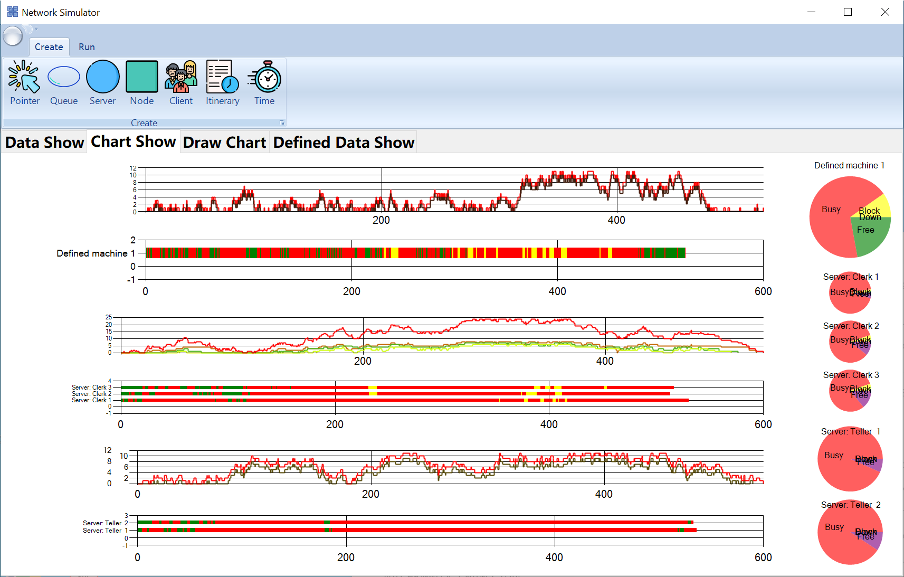
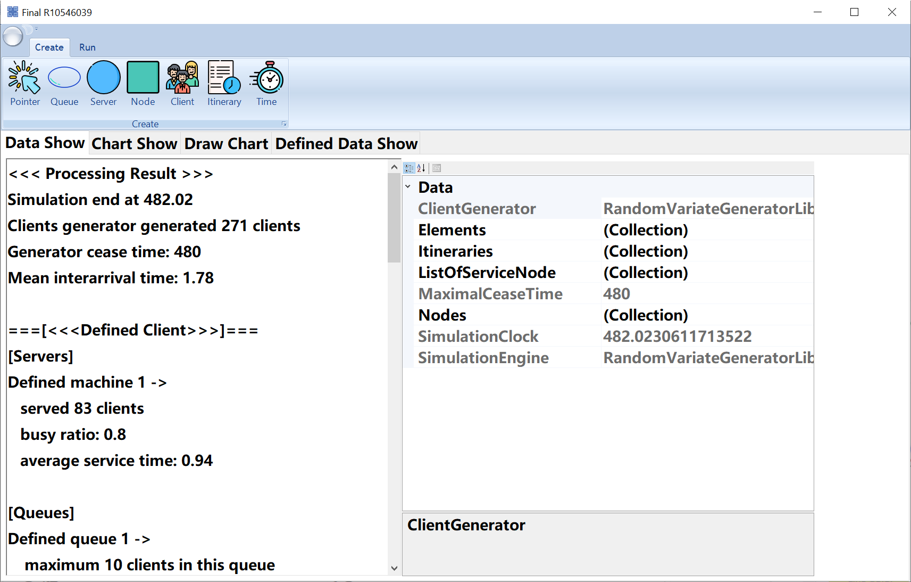

<div align="center">

# 🏢 Network Simulator

**A portable Windows application for object-oriented discrete-event simulation of a three-node service network, with live queue, Gantt, and utilisation charts.**

[](https://learn.microsoft.com/dotnet/csharp/)
[](https://dotnet.microsoft.com/)
[](https://learn.microsoft.com/dotnet/desktop/winforms/)
[](#simulation-engine)
[](#visual-analytics)
[](#download-and-run)
[](LICENSE)

</div>

---

## Download and run

| Item | Path |
|---|---|
| Portable folder | `release/NetworkSimulator/` |
| ZIP package | `release/NetworkSimulator-win64.zip` |

1. Extract the ZIP or open the portable folder.
2. Double-click **`Launch.cmd`**, or run **`NetworkSimulator.exe`**.
3. Windows 10/11 includes the .NET Framework 4.8 runtime.

The bundle contains the executable, simulation library, ribbon dependency, cursor assets, license, and a short `README.txt`.

### Demo mode

```powershell
NetworkSimulator.exe --demo
```

The demo resets the model, runs the simulation to completion, and opens the chart dashboard with queue lengths, server Gantt timelines, and utilisation pies already populated. To stop after a fixed number of events:

```powershell
NetworkSimulator.exe --demo --events 500
```

To open the statistics tab after the run:

```powershell
NetworkSimulator.exe --demo --results
```

---

## Screenshot

<div align="center">
  
  <br>
  <em>Complete run: client-queue lengths, server Gantt timelines, and per-server utilisation pies.</em>
</div>

<br>

<div align="center">
  
  <br>
  <em>Data tab: per-server and per-queue statistics beside the live model inspector.</em>
</div>

---

## What it does

The application simulates customers moving through three service nodes:

1. a **client / washing station** with one machine and a capacity-limited queue;
2. a **bank** with three clerks and three queues;
3. a **fast-food shop** with two tellers and a priority queue.

Customers choose one of two itineraries with different probabilities. Service times are generated from exponential distributions. The simulation engine advances an ordered event queue and records queue lengths, server states, service times, and utilisation.

Features:

- priority event queue;
- reusable `ServiceNode`, `Server`, `Machine`, `TimedQueue`, `Clients`, and `Itinerary` objects;
- exponential, uniform, normal, Bernoulli, geometric, and equilikely random variate generators;
- probabilistic itinerary selection;
- live step-line queue charts;
- RangeBar Gantt charts for every server;
- pie charts for free, busy, blocked, and down time;
- per-server and per-queue statistics;
- a visual model editor with pointer, queue, server, node, client generator, itinerary, and service-time tools;
- a clean reset path that clears events, counters, queues, and chart series before a new run.

---

## Simulation engine

```text
Initialize model
  └─ schedule first client arrival
while event queue is not empty:
  ├─ remove earliest event
  ├─ advance simulation clock
  ├─ process event
  │    ├─ arrival → choose itinerary, enter first node, schedule next arrival
  │    └─ service complete → release server, route client, start next service
  └─ record chart points and statistics
```

| Type | Responsibility |
|---|---|
| `DESEngine` | Event queue, clock, event dispatch, run loop, result text. |
| `DiscreteEvent` | Base class for arrivals, service completions, breakdowns, repairs, demand, and supply. |
| `ServiceNode` | Routes arrivals to a free server or the queue with the most vacancy. |
| `Server` / `Machine` | Busy/free/blocked/down state, service generation, Gantt and pie series. |
| `TimedQueue` | FIFO or priority queue with capacity, length trace, and statistics. |
| `ClientGenerator` | Interarrival generation, itinerary sampling, cease-time stopping. |
| `Itinerary` | Ordered service nodes, probability, priority, and processing-time generators. |
| `Clients` | Birth time, itinerary index, queue/service timestamps, routing. |

### Reset semantics

A correct simulation restores a pristine state, not just the clock. Reset now:

- clears the future-event list,
- resets the simulation clock and last-event time,
- resets every node, server, and queue counter,
- resets the client generator's probability table and counters,
- schedules exactly one new first arrival.

---

## Visual analytics

| Chart | Meaning |
|---|---|
| **Client step line** | Number of clients at the client node over time. |
| **Queue step lines** | Queue length for each queue. |
| **Server Gantt** | Busy/free/blocked intervals for each server. |
| **Utilisation pie** | Share of time each server spent busy, free, blocked, or down. |
| **Data tab** | End-of-run statistics and the live model property inspector. |

### Measured run

| Metric | Value |
|---|---:|
| Simulation end | 482.02 |
| Clients generated | 271 |
| Mean interarrival time | 1.78 |
| Client node served | 83 |
| Client queue maximum | 10 |
| Bank clerks served | 9 / 14 / 17 |
| Fast-food tellers served | 23 / 16 |
| Maximum bank queue | 8 |
| Maximum fast-food queue | 4 |

Values are stochastic and vary between runs.

---

## Controls

| Control | Action |
|---|---|
| **Create → Pointer** | Select and inspect model elements. |
| **Queue / Server / Node / Client / Itinerary / Time** | Create or connect model elements on the canvas. |
| **Run → Reset** | Restore the model and clear all charts. |
| **Run → Run One** | Process one event. |
| **Run → Run To End** | Process all events until the generator ceases. |
| **Chart Show** | Inspect the dashboard. |
| **Data Show** | Inspect statistics and model properties. |

---

## Project structure

```text
DiscreteEventSimulation/
├── NetworkSimulation/
│   ├── MMQLibrary/                    # event engine, model objects, random variates
│   ├── NetworkSimulator/              # WinForms dashboard
│   ├── NetworkSimulator.sln
│   └── packages/                      # RibbonWinForms dependency
├── release/
│   ├── NetworkSimulator/
│   └── NetworkSimulator-win64.zip
├── docs/screenshots/
│   ├── main.png
│   └── results.png
├── README.md
└── LICENSE
```

---

## Build from source

**Requirements:** Windows 10/11, Visual Studio 2022/2026 with .NET desktop development, or MSBuild with the .NET Framework 4.8 targeting pack.

```powershell
& 'C:\Program Files\Microsoft Visual Studio\18\Community\MSBuild\Current\Bin\MSBuild.exe' `
  '.\NetworkSimulation\NetworkSimulator.sln' `
  /t:Restore,Build /p:Configuration=Release /v:minimal /nologo
```

Output:

```text
NetworkSimulation\NetworkSimulator\bin\Release\NetworkSimulator.exe
```

Use MSBuild rather than `dotnet build`.

---

## Design notes and fixes

- **Reset now clears the event queue** — a second run no longer inherits stale clients or events.
- **Duplicate chart series removed** — adding the same queue series twice no longer throws a chart-name exception.
- **Probability table rebuilt once** — itinerary probabilities are no longer appended on every arrival.
- **Non-negative timing statistics** — queue and service durations use the correct timestamp order.
- **Guarded summaries** — nodes, queues, and servers with no departures report zero instead of `NaN`.
- **Correct node-to-chart mapping** — bank data is plotted on the bank charts and fast-food data on the fast-food charts.
- **Integer axis labels** — chart axes no longer show long floating-point tick labels.
- **High-DPI manifest** — the layout remains usable at 150 % display scaling.
- **Cursor assets copied to the output** — the visual editor starts from any working directory.
- **Global exception handler** — unexpected errors are logged and shown in a readable dialog.

---

## References

- Banks, J., Carson, J. S., Nelson, B. L., & Nicol, D. M. (2010). *Discrete-Event System Simulation* (5th ed.). Pearson.
- Law, A. M. (2015). *Simulation Modeling and Analysis* (5th ed.). McGraw-Hill.
- Fishman, G. S. (2001). *Discrete-Event Simulation: Modeling, Programming, and Analysis.* Springer.

---

## License

MIT License. See [LICENSE](LICENSE).

<div align="center">

Built with 🏢, 📊 and C# by **Benny Lin**  
[GitHub @BennyLinntu](https://github.com/BennyLinntu)

</div>
